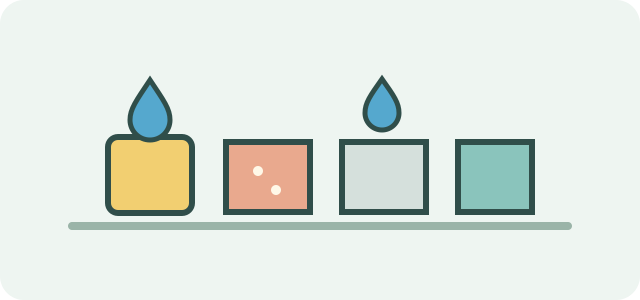

# Day 1 · The Mystery Materials Lab

{ .activity-illustration }

**Field:** Materials science · Scientific method  
**Time:** 10–15 minutes (Tuesday 1 December 2026)  
**Age group:** 6–9  
**Progression:** Our first mission introduces **predict → test → observe**. On [Day 2](day-02.md), children will use the same method to investigate sinking and floating. The materials in this box do **not** need to be saved for later activities.

## Introduction

Can you discover what something is like without knowing its name? Scientists and engineers choose materials by looking closely at their *properties*: whether they feel rough or smooth, bend easily, or soak up water.

By the end of today's mission, the child can:

- Describe two or more properties of a material.
- Predict what will happen, then check the prediction with a fair comparison.
- Sort materials into groups and explain a choice using observations.

**The big question:** Which mystery materials soak up water, and which keep it on the surface?

## Materials list

Only a **small sample** of each material goes in the box.

| Item | Quantity for this activity | Notes |
| --- | --- | --- |
| Kitchen sponge | 1 piece, about 3 × 3 × 1 cm | Cut from a clean, unused sponge. |
| Cotton cloth | 1 square, about 4 × 4 cm | Scrap from an old clean T-shirt is fine. |
| Aluminium foil | 1 square, about 4 × 4 cm | Ordinary kitchen foil. |
| Flexible plastic packaging | 1 square, about 4 × 4 cm | Clean, smooth food packaging; no sharp edges. |

!!! info "Choosing materials"
    Clean household scraps work well. Choose safe materials with different surface properties.

## What's inside the box?

- [ ] **A:** Small piece of clean kitchen sponge, approx. 3 × 3 × 1 cm
- [ ] **B:** Cotton fabric square, approx. 4 × 4 cm
- [ ] **C:** Aluminium foil square, approx. 4 × 4 cm
- [ ] **D:** Smooth plastic square, approx. 4 × 4 cm
- [ ] Folded **Day 1 mission card** (below)

## Child's mission card

!!! example "🔍 DAY 1 — MYSTERY MATERIALS LAB"
    **Your mission:** Discover four materials' superpowers!

    **You need:** Samples, plate, teaspoon, water and towel.

    **1. Explore!** Feel each. Which are soft, smooth, rough or bendy?

    **2. Predict!** Which will soak up water?

    **3. Test!** Lay them flat. Add one drop to each.

    **4. Sort!** Which soak up water? Which keep it on top?

    **5. Choose!** Which makes a better raincoat or spill-wiper?

    ⭐ **Scientist's question:** What surprised you?

!!! example "🔍 DAG 1 — MYSTISKA MATERIAL-LABB"
    **Ditt uppdrag:** Upptäck fyra materials superkrafter!

    **Du behöver:** Prover, tallrik, tesked, vatten och handduk.

    **1. Utforska!** Känn på dem. Vilka är mjuka, släta, sträva eller böjliga?

    **2. Gissa!** Vilka suger upp vatten?

    **3. Testa!** Lägg dem plant. Droppa en droppe på varje.

    **4. Sortera!** Vilka suger upp vatten? Vilka håller det ovanpå?

    **5. Välj!** Vad passar bäst till regnjacka eller att torka spill?

    ⭐ **Forskarens fråga:** Vad överraskade dig?

## Setup notes

### Preparation (2–3 minutes before opening)

1. Cut the four samples to the sizes above. Use an unused sponge and clean scrap fabric/packaging. Remove any sharp or stiff edges from the plastic and foil.
2. Make sure the fabric is absorbent cotton, not coated or water-repellent material. A thin cotton T-shirt scrap is ideal.
3. Mark the samples A–D (without revealing the material names) and pack them with the folded card.
4. Set out the plate or tray, a small cup of tap water, teaspoon and towel on a wipeable surface. Keep the water away from nearby electronics.

### How to help (10–15 minutes total)

| Time | What to do |
| --- | --- |
| 0–3 min | Invite the child to feel and describe the samples. Ask: “How could we sort these?” |
| 3–5 min | Ask for a prediction: which samples will absorb water? Avoid correcting guesses. |
| 5–9 min | Help put **one similarly sized drop** on each sample. Observe before adding more. |
| 9–12 min | Sort by what happened. Ask for evidence: “What did you see?” |
| 12–15 min | Ask the raincoat/spill questions. Wipe up and discard or dry the samples. |

**Keep it a fair test:** Use one drop from the same teaspoon for each material and try to keep the pieces flat. For a stronger contrast, carefully lift the sponge and fabric after a short wait: the water should have soaked in, while foil and smooth plastic hold a bead of water on the surface. If a drop rolls off plastic or foil, that still counts as *not absorbed*.

### Safety

- Check the packaging and foil for sharp edges before packing.
- Use clean materials and a little tap water; dry the surface afterwards.

### Why it works

A **property** is something we can observe or test about a material. Sponges have spaces that hold water. Cotton fibres can take up and transport water between them. Aluminium foil and smooth, non-porous plastic do not absorb water in this short test, so the drops remain on the surface or slide away.

This is the beginning of the **scientific method**: ask a question, make a prediction, keep the test as similar as possible for every sample, and compare what really happened. A prediction that turns out wrong is still useful.

### Troubleshooting and optional extension

- **The fabric seems waterproof:** Try a different clean cotton scrap; synthetic or treated cloth may behave differently.
- **The sponge is already wet:** Start with a dry piece so the difference is easier to see.
- **Drops roll away:** Keep the pieces flat in a shallow plate, and describe the rolling as an observation rather than a failure.
- **Extra challenge for older children:** Make a simple table with rows A–D and columns **soft/hard**, **bendy/stiff** and **absorbs/not absorbs**. Ask whether the materials could be grouped in more than one way.

**Next experiment:** On [Day 2](day-02.md), we will use predictions and careful observations again — this time to ask why some objects float and others sink.

[← Back to the calendar](../index.md)
