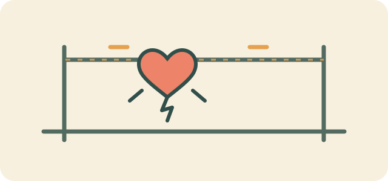

# Day 3 · Balloon Rocket Race

{ .activity-illustration }

**Field:** Physics · Forces and motion · Propulsion  
**Time:** 10–15 minutes (Thursday 3 December 2026)  
**Age group:** 6–9  
**Progression:** On [Day 1](day-01.md) and [Day 2](day-02.md), we learned to **predict → test → observe** and change one feature to improve a design. Today we use that approach to investigate what makes objects move. Tomorrow, on Day 4, we will explore how air affects a falling paper helicopter.

## Introduction

Can a balloon become a rocket without a motor? When air rushes out of an inflated balloon, the balloon moves in the opposite direction. A piece of straw and a string help it travel in a straight line, making the force easy to see.

By the end of the mission, the child can:

- Predict which direction a balloon will travel when its opening faces backward.
- Observe that escaping air can push a balloon forward, even without wings or a motor.
- Change **one variable**—such as the amount of air in the balloon—and compare two launches.

**The big question:** If the air shoots backward, which way does the rocket go?

## Shopping list

| Item | Amount needed | Notes |
| --- | --- | --- |
| Ordinary round balloon | 1, plus 1 spare if available | Use a standard-size balloon that is safe for the child's age; avoid confetti or water balloons. |
| Drinking straw | 1, cut to about 5 cm | Paper or plastic works; the string must slide easily through it. |
| Smooth string | 2–3 m | Thin cotton or synthetic string; smooth and not stretchy. |
| Adhesive tape | About 15–20 cm | Painter's or transparent tape. |
| Printed Day 3 mission card | 1 folded card | Ordinary paper is fine. |

**Household items supplied separately:** two stable anchor points (for example, door handles or chair backs), a clear floor area about 2–3 m long, scissors for the adult, and optionally a hand pump to inflate the balloon. String and tape may be household supplies rather than purchases.

## What's inside the box?

- [ ] **One uninflated balloon**, plus an optional spare, folded loosely.
- [ ] **One straw piece about 5 cm long**, cut by an adult.
- [ ] **One folded Day 3 mission card** (below).

**Packing:** All three items easily fit in the **7 × 7 × 7 cm** box. Keep the **2–3 m string**, tape, scissors and anchor points outside the box as household supplies. The balloon is only inflated **after** opening the box.

## Child's mission card

!!! example "🚀 DAY 3 — BALLOON ROCKET RACE"
    **Your mission:** Make a balloon rocket zoom along a string using only air!

    **You need:** Your balloon and straw, a grown-up, string, tape, and two places to tie the string.

    **1. Predict!** If air rushes out of the balloon backward, which way will your rocket travel?

    **2. Build!** Ask your grown-up to thread the string through the straw and stretch the string tight. Blow up the balloon, but **don't tie it**. Pinch the opening closed.

    **3. Attach!** While the grown-up holds the balloon, tape it to the straw. Point the balloon's opening toward the **start** of the track.

    **4. Launch!** Count down: **3, 2, 1 ... GO!** Let go of the opening. Watch the rocket fly!

    **5. Experiment!** Try again with **less air** in the balloon. Does it travel as far? Change only the amount of air.

    ⭐ **Scientist's question:** Why does the rocket move forward when the air shoots backward?

!!! example "🚀 DAG 3 — BALLONGRAKETEN"
    **Ditt uppdrag:** Få en ballongraket att susa längs ett snöre med hjälp av bara luft!

    **Du behöver:** Din ballong och ditt sugrör, en vuxen, snöre, tejp och två ställen att fästa snöret.

    **1. Gissa!** Om luften strömmar bakåt ur ballongen, åt vilket håll åker raketen?

    **2. Bygg!** Be en vuxen trä snöret genom sugröret och spänna snöret. Blås upp ballongen, men **knyt inte**. Nyp ihop öppningen.

    **3. Fäst!** Medan den vuxna håller i ballongen tejpar ni fast den på sugröret. Rikta ballongens öppning mot banans **start**.

    **4. Skjut iväg!** Räkna ner: **3, 2, 1 ... KÖR!** Släpp öppningen. Se raketen fara iväg!

    **5. Undersök!** Försök igen med **mindre luft** i ballongen. Åker den lika långt? Ändra bara mängden luft.

    ⭐ **Forskarens fråga:** Varför åker raketen framåt när luften sprutar bakåt?

## Adult instructions

### Preparation (3–5 minutes, before opening)

1. Cut the straw to approximately **5 cm** and check that the chosen string can pass through it without catching.
2. Choose a clear track of **2–3 m** between stable anchor points. Thread the string through the straw, tie one end, and leave the other end ready to secure. Keep the track at a comfortable height and **away from faces, doorways, walking routes and pets**.
3. Check that the balloon can be inflated and taped to the straw without blocking the string. If the child cannot inflate it easily, prepare a **hand pump** or plan for the adult to inflate it.
4. Pack the uninflated balloon, straw and folded card in the box. Leave string, tape and scissors outside.

### How to help (10–15 minutes total)

| Time | What to do |
| --- | --- |
| 0–2 min | Ask which way the rocket should move when air escapes. Let the child point. |
| 2–5 min | Pull the string taut, inflate the balloon, pinch it closed and tape the balloon to the straw with the nozzle facing back along the string. |
| 5–7 min | Hold the straw near the starting anchor, count down and release the balloon opening without throwing the balloon. |
| 7–11 min | Repeat with **less air**. Keep the same balloon, track, straw and launching position. Compare how far it travels. |
| 11–15 min | Talk about what moved and what pushed it. Remove the string and collect balloon pieces. |

**Fair-test reminder:** Comparing distances is easiest with the string at the **same angle and tension**, the **same launch point**, and the **same balloon** for both trials. The only intended change is how much the balloon is inflated. Results can vary because the balloon's shape and friction change as it deflates; different distances are observations, not guarantees.

### Safety

- **A grown-up must supervise balloons.** Uninflated or burst balloons can cause choking. Keep balloons and fragments away from children under 8 who are unsupervised, younger siblings, and pets; collect and discard broken pieces immediately.
- **Check for latex allergies** before using a latex balloon. If latex is unsuitable, select a compatible latex-free balloon and test it in advance.
- An adult should handle **scissors, tying the line, and any difficult inflation**. A hand pump is preferable to repeated mouth inflation.
- Keep the string under adult control: do not wrap it around a child or stretch it across a passageway. Do not launch toward people's faces.
- Use only air—**never gas cylinders, flames, or compressed-air equipment**.

### Why it works

The inflated balloon contains air under pressure. When its opening is released, air flows **backward** out of the nozzle. The balloon experiences a force in the **opposite direction**, which pushes it **forward**. This is an example of **Newton's third law**: forces come in equal and opposite pairs, acting on different things.

The string does not power the rocket. It is a **guide**: the straw slides along it so the balloon moves mostly in one direction instead of tumbling around the room. The rocket eventually slows as the balloon runs out of air and friction and air resistance act against its motion.

A balloon with more air may travel farther or faster, but the result is not guaranteed: its mass, shape, air flow and rubbing against the string also matter. That makes the second launch an experiment worth observing.

### Troubleshooting and optional extension

- **The rocket barely moves:** Make the string taut, remove tape rubbing against the string, use a straight straw segment and ensure the balloon opening points along the string toward the start.
- **The balloon falls off:** Dry the balloon, use two pieces of tape across its body, and leave the nozzle completely open.
- **The straw jams:** Use thinner or smoother string; check that there are no knots or tape on the moving part of the track.
- **Air escapes before launch:** One adult can pinch the balloon's neck while the child attaches the tape; use a pump if helpful.
- **Extra challenge for older children:** Mark the landing point for each trial using removable paper markers. Repeat each amount of air twice and compare the results. Ask what makes a comparison fair.

**Next experiment:** Day 4's **Flying Helicopter** will investigate how air changes the motion of something falling toward the ground.

[← Back to the calendar](../index.md) · [← Day 2: Sink or Float?](day-02.md)
