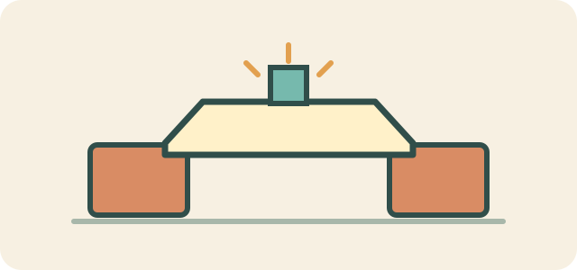

# Day 5 · Build, Test and Improve a Bridge

{ .activity-illustration }

**Field:** Engineering · Structures · Forces  
**Time:** 20–30 minutes (Saturday 5 December 2026)  
**Age group:** 6–9  
**Progression:** Days 2–4 explored how shape affects floating, falling and motion. Today we compare a flat paper bridge with one that has folded edges. Tomorrow, we begin a chemical-reaction investigation.

## Introduction

Can a simple fold make a paper bridge stronger? Test one flat sheet, then fold the second sheet into a shallow channel and compare how many coins each bridge holds.

By the end of this mission, the child can:

- Compare a flat paper sheet with one that has folded edges.
- Keep the supports, load and test conditions the same for a fair comparison.
- Explain how a structure's shape can change how well it resists bending.

**The big question:** Can changing only the paper's shape help a bridge hold more weight?

## Materials list

Reuse clean printer paper if available.

| Item | Amount needed | Notes |
| --- | --- | --- |
| Ordinary printer paper | 2 A4 sheets | Use sheets of the same size and type; one stays flat and one is folded. |
| Small paper cup | 1 | Holds the coins during both tests; choose one about 6 cm wide. |
| Similar coins | About 30 | Use the same coins for both tests. |

## What's inside the box?

- [ ] **Two A4 sheets of the same printer paper**, folded for packing.
- [ ] **One small paper cup** for holding the test coins.
- [ ] **One folded Day 5 mission card** (below).

## Child's mission card

!!! example "🌉 DAY 5 — BUILD, TEST AND IMPROVE A BRIDGE"
    **Your mission:** Can a fold help a paper bridge hold more coins?

    **You need:** Paper, cup, supports and coins.

    **1. Predict!** Which bridge will hold more: flat or folded?

    **2. Test flat!** Set supports 15 cm apart. Centre a cup and add coins one by one.

    **3. Fold and test!** Fold 2 cm edges up on the second sheet. Repeat the test.

    **4. Compare!** Which bridge held more? What changed?

    ⭐ **Scientist's question:** How do the folded sides help?

!!! example "🌉 DAG 5 — BYGG, TESTA OCH FÖRBÄTTRA EN BRO"
    **Ditt uppdrag:** Kan en vikning hjälpa bron att bära fler mynt?

    **Du behöver:** Två papper, mugg, mynt och två stadiga bokstöd.

    **1. Gissa!** Vilken bro bär mest: platt eller vikt?

    **2. Testa platt!** Ställ stöden 15 cm isär. Lägg en mugg i mitten och fyll med mynt, ett i taget.

    **3. Vik och testa!** Vik upp 2 cm längs långsidorna på det andra arket. Upprepa testet.

    **4. Jämför!** Vilken bro bar mest? Vad ändrades?

    ⭐ **Forskarens fråga:** Hur hjälper de vikta kanterna?

## Setup notes

### Preparation (3–5 minutes before opening)

1. Choose two stable book supports of the same height and set them on a sturdy table with a **15 cm gap**. Leave clear space beneath the bridge.
2. Set out the two matching A4 sheets, paper cup and about **30 similar coins**. Keep the same cup, coins and supports for both tests.
3. Keep one sheet flat. Set a ruler and pencil nearby to record each coin count.
4. Pack both sheets, the cup and mission card. Keep the supports and coins outside the box.

### How to help (20–30 minutes total)

| Time | What to do |
| --- | --- |
| 0–3 min | Show both sheets and invite a prediction: will the flat or folded bridge hold more coins? |
| 3–10 min | Centre the first sheet across the 15 cm gap, with about 3 cm on each support. Place the cup in the middle and add coins one at a time. Stop if the paper touches the table, slides or the cup tips; record the count. |
| 10–13 min | Fold a 2 cm strip up along each long edge of the second sheet to make a shallow channel. |
| 13–21 min | Repeat with the folded sheet, using the same gap, cup and coins. Add coins one at a time and record the count at the same stop point. |
| 21–30 min | Compare the results. Ask what changed and what stayed the same, then clear the coins and supports. |

**Keep it a fair test:** Use the same supports, **15 cm gap**, cup and coins. Centre each bridge and load, and stop at the same point each time: when the paper touches the table, starts to slide, or the cup tips. Only the paper's shape should change.

### Safety

- Use stable books on a sturdy table, away from the edge.
- Use a lightweight, unbreakable cup. Add coins gently and stop before the bridge or cup can fall.
- Keep hands and faces out from under the loaded bridge. Do not use glass, heavy objects or people as loads.

### Why it works

The books support the two ends of each paper bridge. A flat sheet bends easily because it is thin. Folding the long edges upward makes a shallow channel that is harder to bend downward. The paper and test setup stay the same, so the comparison shows how a change in **shape** affects the bridge.

### Troubleshooting and optional extension

- **The paper slides off the books:** Make sure it overlaps each support by about 3 cm, and move the books so the gap is exactly 15 cm.
- **The books wobble:** Use wider, stable books on a level table. Do not stack unstable supports.
- **The paper touches the table before the cup is loaded:** Use supports that provide more clearance beneath the bridge, while keeping their height the same.
- **The cup tips:** Use a lighter, wider cup and place it carefully at the centre before adding coins.
- **The folded bridge tips sideways:** Make both edge folds the same height and keep the open channel facing up.
- **Extra challenge for older children:** Try a different fold height with a fresh sheet. Predict first, and change only the fold height.

**Next experiment:** On [Day 6](day-06.md), we will use a chemical reaction to inflate a balloon.

[← Back to the calendar](../index.md) · [← Day 4: The Flying Helicopter](day-04.md)