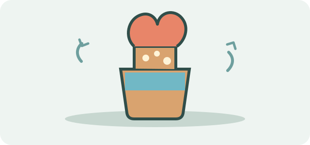

# Day 6 · Build a Bridge: Part 2

{ .activity-illustration }

**Field:** Engineering · Structures · Fair testing  
**Time:** 20–30 minutes (Sunday 6 December 2026)  
**Age group:** 6–9  
**Progression:** On [Day 5](day-05.md), we tested a flat paper bridge and observed where it bent. Today we compare a flat sheet with a folded one, keeping the materials and test setup the same. This is the final bridge challenge in Week 1.

## Introduction

Yesterday's paper bridge bent under a load. Can a simple fold make the same paper stronger? Test one flat sheet, then fold the second sheet into a shallow channel and compare how many coins each bridge holds.

By the end of this mission, the child can:

- Use yesterday's test as a starting point for improving a design.
- Compare a flat sheet and a folded sheet while keeping other conditions the same.
- Explain that a structure's shape can change how well it resists bending.

**The big question:** Can changing only the shape make a paper bridge hold more weight?

## Shopping list

Prices are indicative estimates for the small amounts used, not live shop quotations. Use the same type of paper for both bridges; printer paper from one pack is ideal.

| Item | Amount needed | Estimated cost (SEK) | Notes |
| --- | --- | ---: | --- |
| Ordinary printer paper | 2 A4 sheets | 2–8 | Use two sheets of the same weight and size; one stays flat and one is folded. |
| Small paper cup | 1 | 2–5 | Holds the coins during both tests; choose one about 6 cm wide so it fits in the box. |
| Printed Day 6 mission card | 1 folded card | 0–2 | Ordinary paper is fine. |
| **Estimated materials used** | | **4–15** | Under the **100 SEK per activity** limit. |

**Household items supplied separately:** the same two stable book supports, sturdy table, lightweight cup, about 30 similar coins, ruler and pencil used on Day 5. If the Day 5 setup is unavailable, use matching supports and the same 15 cm gap.

## What's inside the 7 × 7 × 7 cm box?

- [ ] **Two A4 sheets of the same printer paper**, folded for packing.
- [ ] **One small paper cup** for holding the test coins.
- [ ] **One folded Day 6 mission card** (below).

**Packing:** Fold the two sheets into compact rectangles and place them with the folded card inside the paper cup. Unfold and flatten both before starting. The folded bridge shape is made during the activity. Keep the books, coins, ruler and pencil outside the box.

## Child's mission card

!!! example "🌉 DAY 6 — BUILD A BRIDGE: PART 2"
    **Your mission:** Improve a paper bridge by changing its shape!

    **You need:** Two matching sheets of paper and the cup in your box, two book supports and coins.

    **1. Predict!** Which bridge will hold more coins: a flat sheet or one with folded-up sides?

    **2. Test the flat bridge!** Ask your grown-up to set the same 15 cm gap as yesterday. Lay one sheet flat across it. Put the cup in the middle and add coins one at a time. Count until the paper touches the table below or starts to slide.

    **3. Fold and test!** Fold a 2 cm strip up along each short edge of the second sheet to make a shallow channel. Use the same gap, cup and coins. How many can it hold?

    **4. Compare!** Which bridge held more? What did you change, and what stayed the same?

    ⭐ **Scientist's question:** Why might folded sides help the bridge?

!!! example "🌉 DAG 6 — BYGG EN BRO: DEL 2"
    **Ditt uppdrag:** Förbättra en pappersbro genom att ändra formen!

    **Du behöver:** Två likadana pappersark och muggen i lådan, två bokstöd och mynt.

    **1. Gissa!** Vilken bro bär flest mynt: ett platt ark eller ett med uppvikta kanter?

    **2. Testa den platta bron!** Be en vuxen ordna samma mellanrum på 15 cm som i går. Lägg ett ark platt över det. Ställ muggen i mitten och lägg i mynt ett i taget. Räkna tills pappret nuddar bordet under bron eller börjar glida.

    **3. Vik och testa!** Vik upp en 2 cm bred remsa längs arkets båda kortsidor så att det blir en grund ränna. Använd samma mellanrum, mugg och mynt. Hur många mynt klarar den?

    **4. Jämför!** Vilken bro bar flest mynt? Vad ändrade du och vad var likadant?

    ⭐ **Forskarens fråga:** Varför kan uppvikta kanter hjälpa bron?

## Adult instructions

### Preparation (3–5 minutes before opening)

1. Prepare the same stable setup as Day 5: two supports of equal height on a sturdy table, with a **15 cm gap** between their inside edges and clear space beneath the bridge. If possible, use the same books and table.
2. Check that the two A4 sheets are the same size and type. Unfold and flatten them. Keep one flat as the control; fold the second only when the child is ready to build. Set out the paper cup from the box.
3. Set out the same lightweight cup and approximately **30 similar coins** used on Day 5. Keep the ruler and pencil nearby to record each result.
4. Pack the two paper sheets, paper cup and folded card. The coins, supports and ruler stay outside the box.

### How to help (20–30 minutes total)

| Time | What to do |
| --- | --- |
| 0–4 min | Recall yesterday's flat-bridge result. Ask what one change might make it bend less. Let the child predict before building. |
| 4–9 min | Place the first sheet flat across the same 15 cm gap, with about 3 cm resting on each support. Centre the cup and add coins one at a time until the paper touches the tabletop below or starts to slide. Record the count. |
| 9–15 min | Remove the load. On the second sheet, help the child measure a 2 cm strip along each long edge and fold both edges upward to form a shallow channel. Keep the broad middle flat. |
| 15–22 min | Place the folded bridge across the same gap with its open side up. Use the same cup and coins, adding them one at a time in the centre. Stop if the paper touches the tabletop below, starts to slide, or the cup starts to tip; record the count. |
| 22–30 min | Compare the two results. Ask what changed and what stayed the same. Discuss whether the folded bridge was an improvement and why. |

**Keep it a fair test:** Both sheets should be the same size and paper type. Keep the supports, **15 cm gap**, cup, coins, loading position and stop rule the same. The intended change is the second sheet's shape. If the Day 5 sheet is available and still flat, the child can use it as the flat control instead of one new sheet.

### Safety

- An adult should set up and check that the book supports cannot wobble or slide. Keep the bridge away from table edges.
- Use a lightweight, unbreakable cup. Add coins gently and stop before the bridge or cup can fall.
- Supervise coins; keep them away from mouths and younger children, and count them back into the bowl after testing.
- Keep hands and faces out from under the loaded bridge. Do not use glass, heavy objects or people as loads.

### Why it works

A flat sheet is easy to bend because it is thin. Folding the long edges upward makes a shallow channel. Those raised sides make the paper harder to bend downward, much as the shaped beams in bridges and buildings resist bending better than a flat sheet of the same material.

The paper, gap and load stay as similar as possible, so the comparison shows the effect of **shape**. A bridge does not become stronger simply because it has more material here: both designs use one sheet. The folded design may hold more coins, but careful folds and a centred load matter too.

### Troubleshooting and optional extension

- **The flat bridge does not sag:** Check that the gap is 15 cm and the cup is centred. Continue adding coins carefully, or compare the amount of sag under the same fixed number of coins.
- **The folded bridge tips sideways:** Make both edge folds the same height and keep the open channel facing upward. Centre it on the supports.
- **The folded sides flatten:** Crease the folds firmly along a ruler and keep the 2 cm sides upright along the full span.
- **The paper slides off a support:** Restore the 15 cm gap and make sure each sheet overlaps both supports by about 3 cm.
- **Extra challenge for older children:** Try a different fold height with a fresh sheet. Predict first, and change only the fold height while keeping the other test conditions the same.

**Next experiment:** The bridge challenge is complete. On Day 7, we will investigate how vibrations carry sound through a string telephone.

[← Back to the calendar](../index.md) · [← Day 5: Build a Bridge, Part 1](day-05.md)