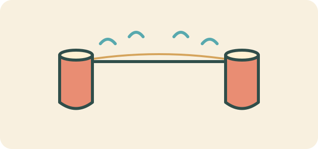

# Day 7 · The Secret String Telephone

{ .activity-illustration }

**Field:** Physics · Sound · Vibrations  
**Time:** 10–15 minutes (Monday 7 December 2026)  
**Age group:** 6–9  
**Progression:** Week 2 begins with sound. On Days 1–6, we explored materials, forces and structures. Today we investigate how vibrations travel through a tight string. Tomorrow, we will explore how syrup, water and oil form layers.

## Introduction

Can a whisper travel along a string? Make a simple telephone from two cups and a taut string. Speak into one cup and listen at the other, then change the string tension to see what happens.

By the end of this mission, the child can:

- Describe sound as something made by vibrations.
- Observe that a tight string can carry vibrations between two cups.
- Compare a taut string with a slack one.

**The big question:** How does your voice travel from one cup to the other?

## Materials list

Household cups and string can be reused.

| Item | Amount needed | Notes |
| --- | --- | --- |
| Small paper cup | 2, about 120 ml | Choose cups about 6 cm wide so they can be nested in the box. |
| Smooth string | 2 m | Thin, non-stretch cotton string works best. |

## What's inside the box?

- [ ] **Two small paper cups**, nested together.
- [ ] **Two metres of string**, loosely coiled.
- [ ] **One folded Day 7 mission card** (below).

## Child's mission card

!!! example "📞 DAY 7 — THE SECRET STRING TELEPHONE"
    **Your mission:** Send a secret message through string!

    **You need:** Two cups and string.

    **1. Build!** Thread the string through each hole and knot it inside.

    **2. Stretch!** Hold one cup each. Step apart until the string is taut and clear.

    **3. Listen!** Speak softly; your partner listens. Swap turns.

    **4. Test!** Loosen the string, then tighten it. What changes?

    ⭐ **Scientist's question:** What vibrates?

!!! example "📞 DAG 7 — DEN HEMLIGA SNÖRTELEFONEN"
    **Ditt uppdrag:** Skicka hemliga meddelanden med snöre!

    **Du behöver:** Två muggar och snöre.

    **1. Bygg!** Trä snöret genom hålen och knyt.

    **2. Spänn!** Håll varsin mugg. Gå isär tills snöret är spänt och fritt.

    **3. Lyssna!** Tala tyst; kompisen lyssnar. Byt tur.

    **4. Testa!** Slaka på snöret, spänn igen. Vad ändras?

    ⭐ **Forskarens fråga:** Vad vibrerar?

## Setup notes

### Preparation (2–3 minutes before opening)

1. Use a pencil tip to make one small hole in the centre of each cup bottom. Keep the holes just large enough for the string.
2. Thread one end of the string through each hole and tie a large knot inside each cup so it cannot pull back through. Check the knots and string before giving the telephone to the child.
3. Choose a clear space where two people can stand about 2 m apart. The string must be able to stretch without crossing a walkway.
4. Pack the cups, string and folded card.

### How to help (10–15 minutes total)

| Time | What to do |
| --- | --- |
| 0–2 min | Ask how a voice might travel through a cup and string. Invite a prediction. |
| 2–5 min | Help the child hold one cup at each end and move apart until the string is taut. Keep the string clear of objects. |
| 5–9 min | Take turns speaking softly into one cup while the other person listens. Try a short word or number. |
| 9–12 min | Repeat with slack string, then make it taut again. Ask which version was easier to hear. |
| 12–15 min | Discuss what moved and collect the cups and string. |

**Keep it a fair comparison:** Keep the cups, speakers, words and distance the same. Change only whether the string is taut or slack. Make sure the string is not touching a wall, table or another object.

### Safety

- Keep string away from necks and do not wrap it around anyone or run while holding it.
- Speak at a comfortable volume; do not shout into a cup or press it forcefully against an ear.

### Why it works

Your voice makes the air inside the cup vibrate. The cup bottom passes those vibrations into the taut string. Vibrations travel along the string and make the other cup vibrate, which makes the air inside it vibrate and carries sound to the listener's ear.

A taut string carries the vibrations more effectively than a slack string. If the string touches something, some energy can pass into that object and the sound may become quieter. The telephone does not send electricity; it passes mechanical vibrations through the string.

### Troubleshooting and optional extension

- **The sound is very quiet:** Check that the string is taut, the knots are secure and the string is not touching anything between the cups.
- **The string pulls through a cup:** Make a larger knot inside. Do not use a sharp object as a stopper.
- **The cups crumple:** Hold them gently by the sides and speak softly.
- **Extra challenge for older children:** Try a longer string or compare two different string materials. Change one thing at a time and keep the string taut for each test.

**Next experiment:** On [Day 8](day-08.md), we will make a bubbling lava lamp with coloured water, oil and an effervescent tablet.

[← Back to the calendar](../index.md) · [← Day 6: Chemical Balloon Inflation](day-06.md)