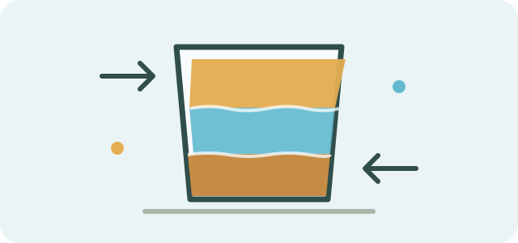

# Day 8 · The Bubbling Lava Lamp

{ .activity-illustration }

**Field:** Chemistry · Density · Gases\
**Time:** 10–15 minutes (Tuesday 8 December 2026)  
**Age group:** 6–9  
**Progression:** On [Day 7](day-07.md), we followed sound vibrations through a string. Today we watch gas carry coloured water through oil. Tomorrow, we will test how soap changes the surface of water.

## Introduction

Can you make a bubbling lamp without electricity? Layer coloured water and cooking oil in a clear container, then add a small piece of an effervescent tablet and watch the bubbles rise.

By the end of this mission, the child can:

- Observe that oil and water form separate layers.
- Describe how gas bubbles carry coloured water upward.
- Explain why the coloured water sinks back down after bubbles pop.

**The big question:** What makes the coloured bubbles travel up and down?

## Materials list

| Item | Amount needed | Notes |
| --- | --- | --- |
| Clear, unbreakable container | 1, about 300 ml | Use a tall glass or clear plastic cup on a tray. Never use a sealed container. |
| Water | About 100 ml | Warm, not hot. |
| Vegetable oil | About 100 ml | Ordinary cooking oil. |
| Food colouring | A few drops | Water-soluble colouring. |
| Effervescent tablet | 1 | Break into small pieces; use a simple water-soluble tablet. |

## What's inside the box?

- [ ] **One effervescent tablet.**
- [ ] **One folded Day 8 mission card.**

**Household items to supply separately:** Clear container, water, vegetable oil, food colouring, spoon and tray.

## Child's mission card

!!! example "🧪 DAY 8 — THE BUBBLING LAVA LAMP"
    **Your mission:** Make coloured bubbles rise through oil!

    **You need:** Clear cup, warm water, oil, food colouring and a tablet.

    **1. Predict!** Will the oil mix with the coloured water?

    **2. Layer!** Add coloured water, then the same amount of oil.

    **3. Bubble!** Drop in a small piece of tablet and watch.

    **4. Observe!** What travels up? What sinks back down?

    ⭐ **Scientist's question:** What carries the colour upward?

!!! example "🧪 DAG 8 — GÖR EN LAVALAMPA"
    **Ditt uppdrag:** Få färgade bubblor att stiga genom olja!

    **Du behöver:** Genomskinlig bägare, varmt vatten, olja, karamellfärg och en brustablett.

    **1. Gissa!** Blandar sig oljan med det färgade vattnet?

    **2. Varva!** Häll i färgat vatten och sedan lika mycket olja.

    **3. Bubblor!** Släpp ner en liten bit brustablett och titta.

    **4. Undersök!** Vad stiger? Vad sjunker igen?

    ⭐ **Forskarens fråga:** Vad för färgen uppåt?

## Setup notes

### Preparation (2–3 minutes before opening)

1. Set the clear container on a tray. Prepare about **100 ml warm water** and **100 ml vegetable oil**; the water should feel comfortably warm, never hot.
2. Add a few drops of food colouring to the water. Keep the tablet dry until the child is ready.
3. Break the tablet into small pieces. Pack one piece for the first test and keep the remainder for another round.

### How to help (10–15 minutes total)

| Time | What to do |
| --- | --- |
| 0–2 min | Invite a prediction: will the oil mix with the coloured water, and which liquid will sit on top? |
| 2–5 min | Pour the coloured water into the container, then slowly add the same amount of oil. Pause and observe the layers. |
| 5–9 min | Drop in a small piece of tablet and watch the bubbles carry coloured liquid upward. |
| 9–12 min | Observe the droplets at the surface and as they sink back down. Add another small piece only after the bubbling slows. |
| 12–15 min | Describe the movement, then leave the mixture to settle and wash the container. |

**Keep it a fair test:** Use similar amounts of water and oil, and add tablet pieces one at a time. Do not shake the container.

### Safety

- Use a stable, unbreakable container on a tray. Keep the mixture away from eyes and wipe spills promptly; oil can make surfaces slippery.
- Use warm, not hot, water. An adult should break the tablet.
- Do not drink or taste the mixture. Never put a lid on the container while it is bubbling.

### Why it works

Oil does not mix with water and is less dense, so it forms a layer above the water. The tablet dissolves in the water and releases **carbon dioxide gas**. Bubbles of gas rise through the oil and carry some coloured water with them. At the surface, the gas escapes; the denser water droplets then sink back through the oil.

### Troubleshooting and optional extension

- **The layers are hard to see:** Use a clear container and add a little more food colouring to the water before pouring.
- **The bubbles stop quickly:** Wait until the first piece has dissolved, then add another small piece of tablet.
- **The water and oil were shaken together:** Leave the container undisturbed until the layers become visible again.
- **Extra challenge for older children:** Compare a small tablet piece in cool and warm water, using the same amounts. Predict which will bubble faster.

**Next experiment:** On [Day 9](day-09.md), we will see how a tiny drop of soap changes the surface of pepper-covered water.

[← Back to the calendar](../index.md) · [← Day 7: The Secret String Telephone](day-07.md)
