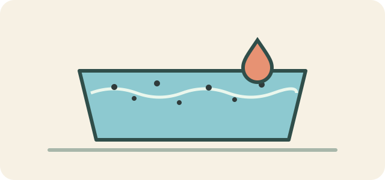

# Day 9 · The Pepper Escape

{ .activity-illustration }

**Field:** Chemistry · Surface tension  
**Time:** 10–15 minutes (Wednesday 9 December 2026)  
**Age group:** 6–9  
**Progression:** On [Day 8](day-08.md), we listened to vibrations in water glasses. Today we observe what happens at the surface of water when a little soap is added. Tomorrow, we will watch coloured water travel through paper.

## Introduction

Can pepper race away from a fingertip? Float a little ground pepper on water, then touch the surface with a soapy cotton swab. Watch the pepper move and investigate what the soap changed.

By the end of this mission, the child can:

- Make a prediction about what will happen when soap touches pepper-covered water.
- Observe movement at the surface of water.
- Describe how soap changes the water's surface tension.

**The big question:** Why does the pepper move away when soap touches the water?

## Shopping list

Household dish soap and water are supplied separately.

| Item | Amount needed | Notes |
| --- | --- | --- |
| Ground black pepper | A small pinch | Fine ground pepper is easiest to see moving. |
| Cotton swabs | 1–2 | One swab can be reused if kept clean. |
| Printed Day 9 mission card | 1 folded card | Ordinary paper is fine. |

**Household items supplied separately:** a shallow dish, cool tap water, a small drop of dish soap, a washable work surface and a towel.

## What's inside the box?

- [ ] **One small, sealed portion of ground black pepper.**
- [ ] **One or two cotton swabs.**
- [ ] **One folded Day 9 mission card** (below).

**Packing:** Put the pepper in a small sealed packet so it cannot spill. The dish, water, soap and towel stay outside the box.

## Child's mission card

!!! example "🌶️ DAY 9 — THE PEPPER ESCAPE"
    **Your mission:** Make pepper scatter across water with one tiny touch!

    **You need:** The pepper and cotton swab in your box, a dish of water, a grown-up and a little dish soap.

    **1. Predict!** What will the pepper do if a soapy swab touches the middle of the water?

    **2. Sprinkle!** Ask your grown-up to add a little water to the dish. Sprinkle a tiny pinch of pepper across the surface.

    **3. Test!** Dip the cotton swab in one drop of dish soap. Gently touch the water in the middle. Watch the pepper move!

    **4. Try again!** Rinse the dish and repeat. What do you notice?

    ⭐ **Scientist's question:** What changed on the water's surface when the soap touched it?

!!! example "🌶️ DAG 9 — PEPPARN SOM FLYR"
    **Ditt uppdrag:** Få peppar att spridas över vatten med en enda liten beröring!

    **Du behöver:** Pepparn och bomullspinnen i lådan, ett fat med vatten, en vuxen och lite diskmedel.

    **1. Gissa!** Vad händer med pepparn om en diskmedelsdoppad bomullspinne rör vid mitten av vattnet?

    **2. Strö!** Be en vuxen hälla lite vatten i fatet. Strö en liten nypa peppar över ytan.

    **3. Testa!** Doppa bomullspinnen i en droppe diskmedel. Rör försiktigt vid vattnet i mitten. Titta när pepparn flyttar sig!

    **4. Prova igen!** Skölj fatet och upprepa. Vad märker du?

    ⭐ **Forskarens fråga:** Vad förändrades på vattenytan när diskmedlet rörde vid den?

## Adult instructions

### Preparation (2–3 minutes before opening)

1. Place a clean, shallow dish on a washable surface and fill it with a thin layer of cool tap water, about **1 cm deep**.
2. Put a tiny pinch of fine ground pepper on a dry plate or in a small dish for sprinkling. Set out a cotton swab and a drop of ordinary dish soap.
3. Keep the pepper packet, swab, dish soap and water away from food and electronics. Pack the pepper, swab and mission card.

### How to help (10–15 minutes total)

| Time | What to do |
| --- | --- |
| 0–2 min | Invite a prediction before the pepper or soap is added. |
| 2–5 min | Help sprinkle a light dusting of pepper over the water. Give it a moment to settle. |
| 5–8 min | Put one small drop of dish soap on the swab. Let the child gently touch the centre of the water once. Observe the pepper's movement. |
| 8–12 min | Rinse and dry the dish, refill with fresh water and repeat. Compare with a clean, dry swab that has no soap. |
| 12–15 min | Discuss what changed and wipe up. Wash hands with soap and water. |

**Keep it a fair comparison:** Use a fresh, clean water surface for each try and about the same amount of pepper. Touch the surface in the centre with one soapy swab touch; avoid stirring or making a splash.

### Safety

- Use only a tiny amount of pepper and dish soap. Do not taste the materials or blow pepper into the air.
- Keep soap and pepper away from eyes and mouths. An adult should rinse eyes with clean water if they are accidentally splashed.
- Wash hands after the experiment and wipe spills promptly. Keep the dish away from younger children and pets.
- Do not mix dish soap with cleaning products or other chemicals.

### Why it works

Water molecules at the surface pull on one another, creating **surface tension**. The pepper is light enough to rest on this surface. Dish soap contains surfactants that lower the surface tension where the soap touches.

The difference in surface tension makes water at the surface move away from the soapy spot. The floating pepper rides along with that moving water, so it appears to dart away. The pepper is not being repelled by a force from the soap itself; it is carried by the surface flow.

### Troubleshooting and optional extension

- **The pepper sinks:** Use fine ground pepper, sprinkle it gently onto still water and do not stir.
- **The pepper barely moves:** Start with a clean dish and fresh water, use a smaller drop of soap, and touch the middle only once.
- **The effect does not repeat:** Soap left in the dish can reduce surface tension everywhere. Rinse thoroughly and dry before trying again.
- **Extra challenge for older children:** Compare what happens when the swab touches the centre and then a spot near the edge. Keep the water and soap amount the same.

**Next experiment:** On [Day 10](day-10.md), we will see water climb along paper towels and carry colour with it.

[← Back to the calendar](../index.md) · [← Day 8: The Musical Water Glasses](day-08.md)