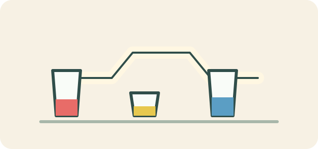

# Day 10 · Walking Rainbow

{ .activity-illustration }

**Field:** Physics · Capillary action · Colour mixing  
**Time:** 10–15 minutes to set up; colour may keep moving afterwards (Thursday 10 December 2026)  
**Age group:** 6–9  
**Progression:** On [Day 9](day-09.md), we explored the surface of water. Today we follow water as it moves through paper and carries colour into empty cups. Tomorrow, we will separate the colours hidden in a marker.

## Introduction

Can water walk from one cup to another? Arrange three cups of coloured water between two empty cups and connect them with folded paper towels. As water travels through the paper, colours meet and mix.

By the end of this mission, the child can:

- Predict how coloured water will move through a paper towel.
- Observe capillary action as water travels through small spaces between fibres.
- Identify new colours made when two primary colours mix.

**The big question:** How can water climb up a paper towel and into another cup?

## Shopping list

Household food colouring and paper towels can be reused.

| Item | Amount needed | Notes |
| --- | --- | --- |
| Paper towels | 4 strips, about 3 × 20 cm | Plain white absorbent paper towels work best. |
| Food colouring | A few drops each of red, yellow and blue | Use liquid colouring if available; colours may stain. |
| Printed Day 10 mission card | 1 folded card | Ordinary paper is fine. |

**Household items supplied separately:** five small clear cups, tap water, a washable tray or plate and a towel.

## What's inside the 7 × 7 × 7 cm box?

- [ ] **Four paper towel strips**, each about 3 × 20 cm, folded loosely.
- [ ] **One folded Day 10 mission card** (below).

**Household items supplied separately:** five cups, water, red/yellow/blue food colouring, a tray and a towel. Keep liquids outside the box to prevent leaks.

## Child's mission card

!!! example "🌈 DAY 10 — WALKING RAINBOW"
    **Your mission:** Help water walk through paper and make new colours!

    **You need:** The paper towel strips in your box, five cups, water, red, yellow and blue colouring, and a grown-up.

    **1. Predict!** What do you think will happen when paper towels connect coloured water to empty cups?

    **2. Set up!** Ask your grown-up to put red water in cup 1, yellow in cup 3 and blue in cup 5. Leave cups 2 and 4 empty.

    **3. Connect!** Fold each paper towel strip into a bridge between two neighbouring cups. Put one end in each cup.

    **4. Observe!** What happens first? Check again later. Which new colours appear in the empty cups?

    ⭐ **Scientist's question:** How did the water travel through the paper?

!!! example "🌈 DAG 10 — DEN VANDRANDE REGNBÅGEN"
    **Ditt uppdrag:** Hjälp vattnet att gå genom papper och skapa nya färger!

    **Du behöver:** Pappersremsorna i lådan, fem muggar, vatten, röd, gul och blå karamellfärg samt en vuxen.

    **1. Gissa!** Vad tror du händer när pappershanddukar kopplar färgat vatten till tomma muggar?

    **2. Gör i ordning!** Be en vuxen hälla rött vatten i mugg 1, gult i mugg 3 och blått i mugg 5. Låt mugg 2 och 4 vara tomma.

    **3. Koppla ihop!** Vik varje pappersremsa till en bro mellan två muggar bredvid varandra. Sätt en ände i varje mugg.

    **4. Titta!** Vad händer först? Titta igen senare. Vilka nya färger syns i de tomma muggarna?

    ⭐ **Forskarens fråga:** Hur kunde vattnet ta sig genom pappret?

## Adult instructions

### Preparation (3–5 minutes before opening)

1. Place five small clear cups in a row on a tray. Add about **60 ml** of water to cups 1, 3 and 5, leaving cups 2 and 4 empty.
2. Add a few drops of food colouring to make cup 1 red, cup 3 yellow and cup 5 blue. Keep the colours distinct; dark colours make mixing harder to see.
3. Fold four paper towel strips lengthwise once to make narrow bridges. Set out a towel for spills. Pack the strips and card only.
4. Keep food colouring away from clothing and surfaces that may stain. An adult can dispense the drops if needed.

### How to help (10–15 minutes to set up and observe)

| Time | What to do |
| --- | --- |
| 0–2 min | Ask the child to predict what will happen in the empty cups. |
| 2–5 min | Place one end of a folded towel strip in each pair of neighbouring cups: 1–2, 2–3, 3–4 and 4–5. |
| 5–10 min | Watch for the paper to become wet and coloured water to start moving. Notice whether drops gather in the empty cups. |
| 10–15 min | Look for colours to meet and mix. Leave the setup on the tray and revisit it later; the process may take longer than the hands-on session. |

**Keep it a fair comparison:** Use similar cup sizes, equal water amounts in the three coloured cups, matching paper towel strips and the same setup height. Do not move the cups while water is travelling.

### Safety

- Use food colouring only in small amounts; it can stain skin, clothes and surfaces. Protect the table and wash hands afterwards.
- Do not drink the coloured water or use the cups for food afterwards until thoroughly washed.
- Wipe up spills promptly and keep the setup away from electronics and younger children or pets.
- An adult should dispense food colouring if the bottle is difficult to control.

### Why it works

Paper towels contain many tiny spaces between their fibres. Water molecules are attracted to the fibres and to one another, so water can move through those spaces and even travel upward against gravity. This movement through narrow spaces is called **capillary action**.

The coloured water follows the same path through the paper. When water from two neighbouring cups reaches an empty cup, the colours mix. Red and yellow make orange; yellow and blue make green. The paper absorbs some water, so the movement may be slow and the final colours may be pale.

### Troubleshooting and optional extension

- **Water does not travel:** Make sure each strip touches the water, use absorbent paper towel rather than coated napkins, and check that neighbouring strips touch through the empty cups.
- **The paper towel falls into a cup:** Refold it into a firmer bridge and rest it securely over each rim.
- **Colours are too dark to mix:** Use fewer drops of colouring and fresh water.
- **The change is slow:** Leave the cups undisturbed and check again in 30–60 minutes. The activity's setup takes 10–15 minutes; the full transfer takes longer.
- **Extra challenge for older children:** Try a different paper type, using the same cup spacing, water volumes and colours. Predict which paper will move water fastest.

**Next experiment:** On [Day 11](day-11.md), we will investigate the hidden colours inside a marker using chromatography.

[← Back to the calendar](../index.md) · [← Day 9: The Pepper Escape](day-09.md)