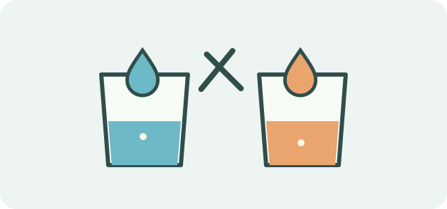

# Day 12 · The Great Dissolving Race

{ .activity-illustration }

**Field:** Chemistry · Solutions · Fair tests  
**Time:** 20–30 minutes (Saturday 12 December 2026)  
**Age group:** 6–9  
**Progression:** On [Day 11](day-11.md), we separated marker pigments with water. Today we test whether sugar dissolves faster in warm or cool water. Tomorrow, we will use a plant-based indicator to investigate acids and bases.

## Introduction

Does sugar disappear faster in warm water or cool water? Measure the same amount of sugar and water into two cups, then stir at the same pace and compare how many turns it takes for the crystals to dissolve.

By the end of this mission, the child can:

- Predict how water temperature affects dissolving.
- Compare two tests while keeping the sugar amount, water volume and stirring similar.
- Describe dissolving as sugar particles spreading through water, not disappearing.

**The big question:** Does sugar dissolve faster in warm water or cool water?

## Shopping list

Prices are indicative estimates for the small amounts used. Use ordinary granulated sugar and household water.

| Item | Amount needed | Estimated cost (SEK) | Notes |
| --- | --- | ---: | --- |
| Granulated sugar | 2 level teaspoons | 0–1 | About 8 g total; pre-portion into two small packets. |
| Printed Day 12 mission card | 1 folded card | 0–2 | Ordinary paper is fine. |
| **Estimated materials used** | | **0–3** | Under the **100 SEK per activity** limit. |

**Household items supplied separately:** two identical clear cups, 200 ml total water, a teaspoon, a measuring cup, a stirring spoon, a towel and a thermometer if available. An adult prepares and handles the warm water.

## What's inside the 7 × 7 × 7 cm box?

- [ ] **Two small packets of granulated sugar**, each containing one level teaspoon.
- [ ] **One folded Day 12 mission card** (below).

**Packing:** Seal the sugar portions separately and place them with the folded card. Cups, water, measuring tools and spoons stay outside the box.

## Child's mission card

!!! example "🏁 DAY 12 — THE GREAT DISSOLVING RACE"
    **Your mission:** Find out whether sugar dissolves faster in warm or cool water!

    **You need:** The two sugar packets in your box, two matching cups, 200 ml water, a spoon and a grown-up.

    **1. Predict!** Which cup will dissolve its sugar in fewer spoon turns: warm water or cool?

    **2. Set up!** Ask your grown-up to measure 100 ml of cool water and 100 ml of warm, not hot, water into separate cups.

    **3. Race!** Add one sugar packet to each cup. Stir each cup gently at the same pace, one turn each second. Count the turns until you can no longer see sugar crystals.

    **4. Compare!** Which cup took fewer turns? Did both cups use the same amount of sugar and water?

    ⭐ **Scientist's question:** Where did the sugar go when it dissolved?

!!! example "🏁 DAG 12 — DEN STORA UPPLÖSNINGSTÄVLINGEN"
    **Ditt uppdrag:** Ta reda på om socker löser sig snabbare i varmt eller kallt vatten!

    **Du behöver:** De två sockerpåsarna i lådan, två likadana muggar, 200 ml vatten, en sked och en vuxen.

    **1. Gissa!** I vilken mugg löser sig sockret med färre skedvarv: varmt eller kallt vatten?

    **2. Gör i ordning!** Be en vuxen mäta upp 100 ml kallt vatten och 100 ml varmt, inte hett, vatten i varsin mugg.

    **3. Tävla!** Häll en sockerpåse i varje mugg. Rör försiktigt i samma takt, ett varv i sekunden. Räkna varven tills du inte längre ser sockerkristaller.

    **4. Jämför!** Vilken mugg behövde färre varv? Använde båda lika mycket socker och vatten?

    ⭐ **Forskarens fråga:** Vart tog sockret vägen när det löstes upp?

## Adult instructions

### Preparation (3–5 minutes before opening)

1. Set out two matching clear cups, a measuring cup, a teaspoon and a stirring spoon. Place the cups on a tray or washable surface.
2. Measure **100 ml** of cool tap water for one cup. Prepare **100 ml of warm water at about 35–40°C** for the other. The adult pours and checks the temperature; do not use hot or boiling water.
3. Portion one level teaspoon of the same granulated sugar into each packet. Pack both portions with the folded card.
4. Keep the cups clearly labelled **cool** and **warm** so the child can compare the results.

### How to help (20–30 minutes total)

| Time | What to do |
| --- | --- |
| 0–3 min | Ask for a prediction and decide together how to count the stirring. |
| 3–6 min | Measure 100 ml of each water temperature into the matching cups. The adult handles the warm cup. |
| 6–12 min | Add the sugar to each cup. Stir at a steady pace, about one full turn each second, and count turns until crystals are no longer visible. Test one cup at a time using the same spoon, rinsed and dried between tests. |
| 12–18 min | Compare turn counts. If time allows, repeat with fresh equal amounts and switch which cup is tested first. |
| 18–30 min | Discuss the result, let both cups cool, then dispose of the sugar water and wash the cups. |

**Keep it a fair test:** Use the same type and amount of sugar, equal water volumes, matching cups and the same stirring rate and spoon. The water temperature is the one intended change. A thermometer helps; otherwise, the adult should use comfortably warm water that is not hot.

### Safety

- An adult must prepare, measure and pour the warm water. Use only comfortably warm water, about **35–40°C**, never hot or boiling water.
- Keep cups on a stable surface and wipe spills promptly. Do not taste the experiment materials.
- Do not use a kettle or hot plate during the child's test. Keep warm water away from younger children and pets.
- Wash hands and rinse the cups after the experiment.

### Why it works

Sugar dissolves when water molecules pull sugar particles away from the crystals and spread them through the liquid. The sugar has not vanished; it is mixed so evenly into the water that the crystals are no longer visible.

In warm water, water molecules move faster and interact with the sugar more often, so the crystals usually dissolve more quickly. Stirring also helps bring fresh water into contact with the sugar. That is why the amount and pace of stirring must stay similar in both tests.

### Troubleshooting and optional extension

- **Sugar remains at the bottom:** Keep stirring at the same pace and count a few more turns. Make sure the water volume was measured correctly.
- **The results are very close:** Repeat with fresh equal amounts, a larger safe difference in water temperature, and the same stirring rhythm.
- **The warm water cools while waiting:** Test one cup at a time and switch the order for a repeat. Record which cup was tested first.
- **Extra challenge for older children:** Compare fine sugar and sugar cubes at the same water temperature. Change only the sugar form and predict which dissolves sooner.

**Next experiment:** On [Day 13](day-13.md), we will make a colour-changing indicator from red cabbage and test safe household liquids.

[← Back to the calendar](../index.md) · [← Day 11: The Colour Detective](day-11.md)