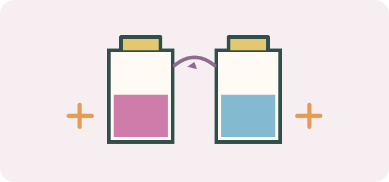

# Day 13 · The Colour-Changing Potion Lab

{ .activity-illustration }

**Field:** Chemistry · Acids and bases · Indicators  
**Time:** 20–30 minutes (Sunday 13 December 2026)  
**Age group:** 6–9  
**Progression:** On [Day 12](day-12.md), we compared dissolving in warm and cool water. Today we use red-cabbage indicator to compare a mild acid, water and a mild base. Next week, we will investigate seeds, the Moon and invisible forces.

## Introduction

Can a purple liquid change colour when it meets a different substance? Red cabbage contains a natural pigment that changes colour in acidic and basic liquids. Test small samples of lemon water, plain water and baking-soda water.

By the end of this mission, the child can:

- Predict whether an indicator will change colour in different liquids.
- Sort sample liquids by their observed indicator colour.
- Explain that an indicator gives clues about acidity or basicity without tasting a substance.

**The big question:** What can a colour change tell us about a liquid?

## Materials list

Make the indicator from a small piece of red cabbage; use household lemon juice and baking soda for testing.

| Item | Amount needed | Notes |
| --- | --- | --- |
| Red cabbage | A few leaves for about 100 ml indicator | Use a small amount from a fresh cabbage. |
| Leakproof small bottle | 1, about 10–15 ml | A clean screw-top sample bottle; double-bag for packing. |
| Lemon juice | A small amount | For one test sample; use tiny quantities and do not taste any samples. |
| Baking soda | A small amount | For preparing another test sample; use tiny quantities and do not taste any samples. |
| Small clear cups | 3 | For the test samples. |

## What's inside the box?

- [ ] **One leakproof bottle of cooled red-cabbage indicator**, about 10–15 ml, sealed inside a second bag.
- [ ] **One small pipette** (optional if using a household teaspoon).
- [ ] **One folded Day 13 mission card** (below).

## Child's mission card

!!! example "🧪 DAY 13 — THE COLOUR-CHANGING POTION LAB"
    **Your mission:** Test mystery liquids with purple cabbage!

    **You need:** Cabbage indicator, three cups, lemon, baking soda, water and adult.

    **1. Predict!** Which liquid will change the indicator's colour?

    **2. Set up!** Ask an adult to put lemon, plain and baking-soda water in separate cups.

    **3. Test!** Add the same number of indicator drops to each. Watch closely.

    **4. Sort!** Which turned pink, stayed purple or became blue-green?

    ⭐ **Scientist's question:** What did the colours show?

!!! example "🧪 DAG 13 — LABBET MED FÄRGÄNDRANDE TROLLDRYCK"
    **Ditt uppdrag:** Testa tre mystiska vätskor med lila kål!

    **Du behöver:** Kålindikator, tre muggar, citron, bikarbonat, vatten och vuxen.

    **1. Gissa!** Vilken vätska ändrar indikatorns färg?

    **2. Gör i ordning!** Be en vuxen förbereda citronvatten, vanligt vatten och bikarbonatvatten i varsin mugg.

    **3. Testa!** Droppa lika mycket indikator i varje. Titta noga.

    **4. Sortera!** Vilket blev rosa, förblev lila eller blev blågrönt?

    ⭐ **Forskarens fråga:** Vad avslöjade färgerna?

## Adult instructions

### Preparation (adult, before the activity)

1. Roughly chop a few red-cabbage leaves. Place them in a heat-safe bowl and cover with about **150 ml hot water**. An adult handles the hot water; steep for 10–15 minutes until the liquid is dark purple.
2. Strain the liquid and let it cool completely. Pour 10–15 ml into a clean, leakproof screw-top bottle. Keep the remaining indicator covered in the refrigerator if it will be used later; discard after a few days.
3. Pack the sealed bottle in a second bag. Set out three small clear cups, lemon juice, a small amount of baking soda, water, a teaspoon and a washable tray.
4. Make two sample solutions: a teaspoon of lemon juice diluted with about 30 ml water; and a small pinch of baking soda stirred into about 30 ml water. Place plain water in the third cup. Keep each sample separate.

### How to help (20–30 minutes total)

| Time | What to do |
| --- | --- |
| 0–3 min | Show the cooled purple indicator and invite predictions about the three samples. |
| 3–7 min | Set up the three labelled samples: lemon water, plain water and baking-soda water. Use a clean spoon for each. |
| 7–12 min | Add the same amount of indicator to each sample, such as 1 teaspoon or 5 drops. Observe the colours without mixing the samples together. |
| 12–18 min | Compare and sort the samples by colour. Ask which one changed most from the purple starting colour. |
| 18–30 min | Discuss what the colours suggest, then dispose of the small samples and wash the cups and tray. |

**Keep it a fair comparison:** Use similar amounts of each sample and the same amount of indicator. Keep the cups separate and use clean spoons or the pipette for each liquid so samples do not contaminate one another.

### Safety

- **An adult prepares the indicator.** Hot water, chopping and straining are adult jobs; cool the liquid fully before it goes in the box.
- Use only small amounts of food-grade cabbage, lemon juice and baking soda. Do not taste or drink any experiment samples.
- Red-cabbage indicator can stain skin, clothing and surfaces. Use a tray, avoid splashes and wash hands afterwards.
- Do not mix these samples with cleaning products or other chemicals. Keep the bottle and samples away from younger children and pets.

### Why it works

Red cabbage contains **anthocyanin** pigments. These pigments change structure in liquids with different acidity, which changes the colours they absorb and reflect. The cabbage indicator is usually pink or red in an acid such as diluted lemon juice, purple near neutral water, and blue or green in a mild base such as baking-soda water.

An **indicator** gives a clue about a liquid's properties; it does not identify every substance or tell us whether something is safe to eat. Colour results can vary with the cabbage, concentration and lighting, so compare the samples with one another rather than relying on an exact shade.

### Troubleshooting and optional extension

- **The indicator is pale:** Steep more cabbage leaves or use less water when preparing it. The cooled liquid should be visibly purple.
- **The lemon sample barely changes:** Add a little more lemon juice, keeping the total sample volume similar, and compare again with fresh indicator.
- **The baking-soda sample barely changes:** Dissolve another small pinch of baking soda in the same amount of water. Do not add a large amount.
- **All samples look similar:** Use clean cups and spoons, add equal indicator amounts and check that the indicator was not diluted or contaminated.
- **Extra challenge for older children:** Test another safe household liquid, such as diluted vinegar, in a separate labelled cup. Predict first and never use cleaners.

**Next experiment:** Week 3 begins on [Day 14](../index.md), where we will start a seed-growing investigation.

[← Back to the calendar](../index.md) · [← Day 12: The Great Dissolving Race](day-12.md)