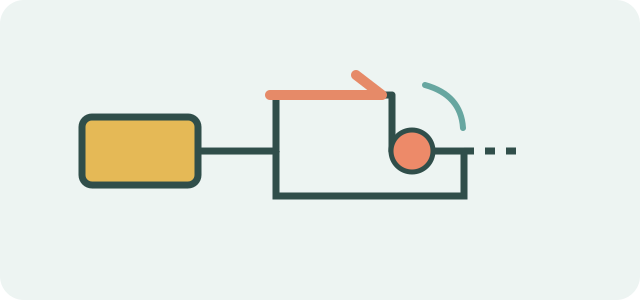

# Day 17 · Light It, Switch It!

{ .activity-illustration }

**Field:** Technology · Electricity · Circuits  
**Time:** 10–15 minutes (Thursday 17 December 2026)  
**Age group:** 6–9  
**Progression:** On [Day 16](day-16.md), we explored an invisible magnetic force. Today we build a complete low-voltage circuit that lights an LED, then add a paperclip switch to turn it on and off. Tomorrow, an Arduino will control the same LED with code, so save the LED and resistor.

## Introduction

Can you make a tiny light shine, and then choose when it turns on? Connect a two-AA battery pack, a current-limiting resistor and an LED in one complete loop. Then add a gap made of two foil pads: when a metal paperclip bridges the gap, the loop closes and the LED lights; lift it away and the light goes out.

By the end of this mission, the child can:

- Identify a battery, LED, resistor and switch as parts of a simple circuit.
- Complete a low-voltage loop that lights an LED.
- Explain that a switch controls the light by opening or closing a gap in the circuit.

**The big question:** What must happen for electricity to flow around the circuit, and how does a switch stop it?

## Materials list

Use a standard red LED and a resistor in series; do not use a loose coin-cell battery.

| Item | Amount needed | Notes |
| --- | --- | --- |
| 2-AA battery holder with leads | 1 | Holds two AA cells in series for about 3 V. No exposed battery terminals. |
| AA alkaline battery | 2 | Ordinary 1.5 V cells; remove them after testing. Do not use mains electricity, chargers or wall adapters. |
| Red 5 mm LED | 1 | Standard through-hole LED. Save it for Day 18. |
| 220-ohm resistor | 1 | Must be connected in series to limit current. Save it with the LED for Day 18. |
| Insulated alligator-clip lead | 3 | For temporary connections; do not let the clips touch each other. |
| Aluminium foil | 2 squares, about 2 × 2 cm | Ordinary kitchen foil, folded once for strength. |
| Large steel paperclip | 1 | The movable metal bridge of the switch. |
| Thin cardboard | 1 piece, about 5 × 6 cm | Base for the foil switch. |
| Insulating tape | A few small pieces | For the LED/resistor joint and the foil pads. |

## What's inside the box?

- [ ] **One two-AA battery holder and two AA batteries**, packed separately so the cells are not installed yet.
- [ ] **One red LED with a 220-ohm resistor pre-connected in series**; insulate the joined legs with tape or heat-shrink.
- [ ] **Three insulated alligator-clip leads.**
- [ ] **One small cardboard switch base** with two foil pads taped on, 5–8 mm apart.
- [ ] **One large steel paperclip.**
- [ ] **One folded Day 17 mission card** (below).

## Child's mission card

!!! example "💡 DAY 17 — LIGHT IT, SWITCH IT!"
    **Your mission:** Light an LED, then switch it on and off!

    **You need:** Battery pack, LED with resistor, leads, foil card and paperclip.

    **1. Predict!** What happens if the circuit has a gap?

    **2. Connect!** Batteries out. Red wire to foil pad 1. Foil pad 2 to the resistor. Short LED leg to black wire.

    **3. Switch!** Put the batteries in. Lay the paperclip across both foil pads. Now lift it off. What happens?

    **4. Discover!** Where else could you make a gap that turns the light off?

    ⭐ **Scientist's question:** Why does the light need a complete loop?

!!! example "💡 DAG 17 — TÄND OCH SLÄCK!"
    **Ditt uppdrag:** Tänd en LED och slå av och på den!

    **Du behöver:** Batterihållare, LED med motstånd, sladdar, foliekort och gem.

    **1. Gissa!** Vad händer om kretsen har ett avbrott?

    **2. Koppla!** Batterierna ute. Röd sladd till foliebit 1. Foliebit 2 till motståndet. LED-lampans korta ben till svart sladd.

    **3. Slå på!** Sätt i batterierna. Lägg gemet över båda foliebitarna. Lyft bort det. Vad händer?

    **4. Upptäck!** Var mer kan du göra ett avbrott som släcker lampan?

    ⭐ **Forskarens fråga:** Varför behöver lampan en hel slinga?

## Setup notes

### Preparation (5–10 minutes before opening)

1. Use a holder for **two AA cells in series** (about 3 V). Pack the cells outside the holder so the circuit cannot be powered before it is checked. Do not use coin cells or a higher-voltage source.
2. Connect a **220-ohm resistor in series with the LED's long leg (anode)**. Twist the resistor leg securely to the LED leg and insulate the exposed joint with electrical tape or heat-shrink. Leave the resistor's other leg and the LED's short leg accessible for clips. Keep the legs straight enough to push into a breadboard tomorrow.
3. Make the switch base: fold the two foil squares once and tape them to the cardboard with a **5–8 mm gap**. Tape each square at one edge only, leaving a clean metal area for a clip to grip and for the paperclip to touch. Label the pads **1** and **2**.
4. Check the holder's red and black wires and the alligator clips; do not let the clips touch each other. Pack everything with the card. Keep water away from the table.

### How to help (10–15 minutes total)

| Time | What to do |
| --- | --- |
| 0–2 min | Identify the battery pack, LED, resistor and foil switch. Ask what the resistor might do and predict what a gap will cause. |
| 2–6 min | With the batteries out, clip the pack's red wire to foil pad 1, foil pad 2 to the free resistor leg, and the LED's short leg to the black wire. Make sure the long LED leg is the one joined to the resistor. |
| 6–9 min | Check that no clips are loose or touching each other, then insert the two AA cells. Lay the paperclip across both pads and observe the LED. |
| 9–12 min | Lift the paperclip to open the switch, then bridge the pads again. Next, unclip one lead elsewhere in the loop: does that also act like a switch? |
| 12–15 min | Remove the batteries. Store the LED/resistor assembly safely for Day 18. |

**Circuit path:** Battery red (+) → foil pad 1 → paperclip → foil pad 2 → resistor → LED long leg → LED short leg → battery black (−). The resistor must stay in series with the LED every time the battery is connected.

### Safety

- Use only a **two-AA, approximately 3 V battery holder** and one LED with a **220-ohm series resistor**. Never connect this circuit to mains electricity, a wall adapter or a USB port.
- Keep the resistor in series with the LED and insulate its joined legs. Do not let the battery wires or alligator clips touch each other; this can short the batteries and heat the wires.
- Keep the circuit dry. Remove the batteries when changing connections and when finished. Do not use damaged batteries or holders.
- Fold foil edges over before taping them down. Disconnect immediately if a wire or battery gets warm.

### Why it works

A battery provides electrical energy. When the connections make one complete loop, electric current can flow from the battery's positive side, through the resistor and LED, and back to the negative side. The LED converts some electrical energy into light. The resistor limits the current and protects the LED.

An LED is a **diode**, so current passes through it mainly in one direction. Its longer leg is usually the positive side (**anode**) and its shorter leg the negative side (**cathode**).

The paperclip is a **conductor**. When it touches both foil pads, it bridges the gap and closes the circuit. Lifting it opens the gap and the current stops everywhere in the loop at once. A switch does not make electricity; it controls whether there is a continuous path for it. Any gap in the loop, such as an unclipped lead, has the same effect.

### Troubleshooting and optional extension

- **The LED does not light:** Remove the batteries. Check that the paperclip touches both pads, the resistor is in series, the long LED leg points toward red (+), and every clip grips bare metal.
- **The LED stays on when the paperclip is lifted:** The pads or clips are touching across the gap. Remove the batteries and widen the gap.
- **The LED flickers:** A clip may not be gripping bare metal. Remove the batteries and adjust the connection.
- **A wire or battery feels warm:** Disconnect immediately and check for a short circuit. Do not use the setup until corrected.
- **Extra challenge for older children:** Draw the circuit as a loop and mark every place where a gap would turn the LED off. Then design a cardboard flap that presses the paperclip down like a doorbell.

**Next experiment:** On [Day 18](day-18.md), an Arduino and a button will control the same LED and switch between blink patterns.

[← Back to the calendar](../index.md) · [← Day 16: The Invisible Magnet Maze](day-16.md)
