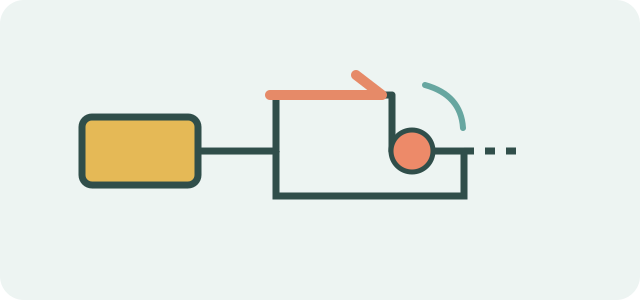

# Day 18 · Invent a Switch

{ .activity-illustration }

**Field:** Technology · Electricity · Circuits  
**Time:** 10–15 minutes (Friday 18 December 2026)  
**Age group:** 6–9  
**Progression:** On [Day 17](day-17.md), we built a complete LED circuit with a two-AA battery pack and a current-limiting resistor. Today we add a paperclip switch that opens and closes the circuit. Save the LED, resistor and leads for Days 19–20 and the final invention.

## Introduction

How can you make a light turn on only when you choose? Add a simple switch to yesterday's LED circuit. When a metal paperclip bridges two foil contacts, the loop closes and the LED lights; lift it away and the loop opens.

By the end of this mission, the child can:

- Identify a switch as a part that opens or closes a circuit.
- Build and test a simple paperclip-and-foil switch.
- Explain why the LED turns off when the switch contacts are separated.

**The big question:** How does a switch control whether current can flow?

## Shopping list

Reuse the Day 17 circuit parts. Only the small switch materials are additional.

| Item | Amount needed | Notes |
| --- | --- | --- |
| Aluminium foil | 2 squares, about 2 × 2 cm | Ordinary kitchen foil, folded once for strength. |
| Large steel paperclip | 1 | Use as a movable metal bridge between contacts. |
| Insulated alligator-clip lead | 1 | Adds a lead so the switch can be inserted into the circuit. |
| Printed Day 18 mission card | 1 folded card | Ordinary paper is fine. |

**Household items supplied separately:** the Day 17 battery holder, two AA batteries, LED with 220-ohm resistor, two clip leads, a small piece of card and insulating tape. The batteries must be removed from the holder while changing the circuit.

## What's inside the box?

- [ ] **Two foil squares**, about 2 × 2 cm each.
- [ ] **One large steel paperclip.**
- [ ] **One additional insulated alligator-clip lead.**
- [ ] **One folded Day 18 mission card** (below).

**Packing:** Fold the foil around a small card to keep it flat. Pack the paperclip separately and coil the lead loosely. The Day 17 circuit parts stay safely stored outside the box until the activity.

## Child's mission card

!!! example "🔘 DAY 18 — INVENT A SWITCH"
    **Your mission:** Add a switch that turns yesterday's LED on and off!

    **You need:** Your Day 17 battery circuit, the foil, paperclip and extra clip lead in this box, plus a grown-up.

    **1. Predict!** What will happen when the paperclip touches both foil contacts? What if it lifts away?

    **2. Build!** Ask your grown-up to disconnect the battery. Put the two foil squares on card with a small gap between them. Connect one foil square to the battery's red wire and the other to the resistor side of the LED circuit.

    **3. Switch!** Touch the paperclip across both foil squares. Ask your grown-up to reconnect the battery. Does the LED light? Lift the paperclip to turn it off.

    **4. Improve!** Can you make the paperclip easier to move without letting the foil contacts touch?

    ⭐ **Scientist's question:** What does the switch change in the circuit?

!!! example "🔘 DAG 18 — UPPFINN EN STRÖMBRYTARE"
    **Ditt uppdrag:** Lägg till en strömbrytare som tänder och släcker gårdagens LED!

    **Du behöver:** Batterikretsen från dag 17, folien, gemet och den extra krokodilsladden i lådan samt en vuxen.

    **1. Gissa!** Vad händer när gemet rör vid båda foliebitarna? Vad händer om det lyfts bort?

    **2. Bygg!** Be en vuxen koppla bort batteriet. Lägg två foliebitar på kartong med ett litet mellanrum. Koppla den ena foliebiten till batterihållarens röda sladd och den andra till LED-kretsens motståndssida.

    **3. Byt läge!** Lägg gemet över båda foliebitarna. Be en vuxen koppla in batteriet igen. Lyser LED-lampan? Lyft bort gemet för att släcka den.

    **4. Förbättra!** Kan du göra gemet lättare att flytta utan att foliebitarna rör vid varandra?

    ⭐ **Forskarens fråga:** Vad förändrar strömbrytaren i kretsen?

## Adult instructions

### Preparation (3–5 minutes before opening)

1. Bring out the Day 17 circuit: two-AA holder, two cells, LED with its **220-ohm resistor in series**, and two clip leads. Remove both cells from the holder before changing any connections. Check the insulation and all components before use.
2. Fold the two foil squares once and place them on a piece of card with a **5–8 mm gap**. Tape each square at one edge so it stays flat, but leave a clean metal area for a clip to grip.
3. With both cells removed, use the extra clip lead to connect one foil pad to the holder's red wire. Use the Day 17 lead to connect the other pad to the free resistor leg. The remaining Day 17 lead connects the LED's short leg to the battery's black wire.
4. Check that the foil pads do not touch and that the paperclip can bridge both. Do not connect the battery until the child is ready to test.

### How to help (10–15 minutes total)

| Time | What to do |
| --- | --- |
| 0–2 min | Recall that a circuit needs a complete loop. Ask what might happen when the two foil pads are connected by metal. |
| 2–6 min | With the battery disconnected, set up the foil pads and clip leads as a gap in the positive side of the Day 17 circuit. Check that the resistor remains in series. |
| 6–9 min | Have the child lay the paperclip across both foil pads. The adult checks for shorts, then inserts the two AA cells. Observe the LED. |
| 9–12 min | Lift the paperclip to open the switch and turn the LED off; bridge the pads again to turn it on. Repeat a few times. |
| 12–15 min | Disconnect the battery and collect the foil and paperclip. Store the clean circuit parts for later missions. |

**Circuit path with switch:** Battery red (+) → foil contact → paperclip switch → second foil contact → resistor → LED long leg → LED short leg → battery black (−). The switch must interrupt only one side of the loop, and the resistor must stay in series.

### Safety

- Use only the same **two-AA, approximately 3 V holder** and 220-ohm resistor from Day 17. Never connect the switch to mains electricity, a wall adapter or a USB port.
- An adult should reconnect the battery only after checking the clips and confirming the foil pads are separate. Disconnect immediately if wires or batteries warm.
- Do not let the battery's red and black wires or loose clips touch each other. Keep the circuit dry and disconnect batteries whenever it is not being tested.
- Foil edges can be sharp and the paperclip has a pointed end. An adult should fold and tape the foil and supervise the clip; keep small parts away from mouths and younger children.

### Why it works

The paperclip is a conductor. When it touches both foil pads, it makes a bridge across the gap and completes the circuit, so current can flow through the resistor and LED. When the clip is lifted, the gap opens, current stops and the LED goes out.

This is the same basic idea used by many everyday switches. A switch does not create electricity; it controls whether there is a continuous path for current. The resistor still limits current to protect the LED.

### Troubleshooting and optional extension

- **The LED stays off:** Disconnect the battery. Check that the paperclip touches both foil pads, the pads connect to the correct circuit points, the LED is oriented correctly and the resistor remains in series.
- **The LED stays on when the clip is lifted:** Check whether the foil pads or alligator clips are touching across the gap. Disconnect the battery and widen the gap.
- **The foil tears or moves:** Fold it around the card and tape one edge, leaving the contact area exposed. An adult can replace damaged foil.
- **A clip or battery feels warm:** Disconnect immediately. Do not reconnect until an adult has found and fixed the short circuit.
- **Extra challenge for older children:** Design a switch that uses a folded card flap to press the paperclip down. Keep the two contacts separate when the flap is raised.

**Next experiment:** On [Day 19](day-19.md), we will use an Arduino to make a light blink with code.

[← Back to the calendar](../index.md) · [← Day 17: Light Up an LED!](day-17.md)