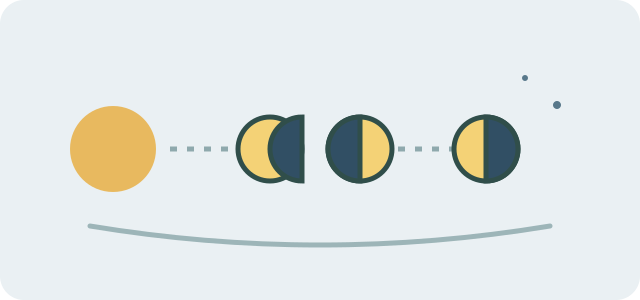

# Day 21 · The Seed Scientist Returns

{ .activity-illustration }

**Field:** Biology · Plant science · Observation  
**Time:** 10–15 minutes (Monday 21 December 2026)  
**Age group:** 6–9  
**Progression:** On [Day 14](day-14.md), we started cress seeds and predicted what would happen. Today we observe the same setup, compare it with the first drawing and talk about what helped the seeds grow. Tomorrow, we will use light flashes to send a secret message.

## Introduction

What changed while we were away? Return to the cress seeds from Day 14 and compare their growth with the first drawing and prediction. A scientist records what happened, even if the result was different from what they expected.

By the end of this mission, the child can:

- Observe and describe changes in a living thing over time.
- Compare a result with an earlier prediction.
- Identify what the seed setup needed and suggest one question to investigate next.

**The big question:** What happened to our seeds, and how did the result compare with our prediction?

## Materials list

This activity uses the Day 14 seed setup and observation record, plus a reusable hand lens.

| Item | Amount needed | Notes |
| --- | --- | --- |
| Day 14 seed setup | 1 | Cress seeds on damp cotton in a clear cup or jar. |
| Small hand lens | 1 | A simple magnifier helps inspect roots and shoots through the cup. |
| Printed Day 21 mission card | 1 folded card | Ordinary paper is fine. |
| Day 14 seed setup | 1 | Reuse the cress seeds on damp cotton in their clear cup or jar. If it has mould or smells unpleasant, do not handle it; discard it with adult help and use the original records instead. |
| First drawing or notes | 1 set | The child's Day 14 observation record. |
| Pencil | 1 | For recording today's observations. |

## What's inside the box?

- [ ] **One small hand lens** for looking closely at the seedlings.
- [ ] **One folded Day 21 mission card** (below).

**Household items to supply separately:** the living or discarded Day 14 seed setup and the child's observation record. Nothing else is needed in the box.

## Child's mission card

!!! example "🌱 DAY 21 — THE SEED SCIENTIST RETURNS"
    **Your mission:** Revisit your seeds. What changed?

    **You need:** Day 14 seed cup, hand lens, first drawing or notes, pencil and adult.

    **1. Predict!** What did you expect to happen?

    **2. Observe!** Look closely at seeds, roots and shoots. Draw today's growth.

    **3. Compare!** What differs from your first drawing? Anything surprising?

    **4. Wonder!** What would you investigate next?

    ⭐ **Scientist's question:** What shows the seed is growing?

!!! example "🌱 DAG 21 — FRÖFORSKAREN ÅTERVÄNDER"
    **Ditt uppdrag:** Titta till fröna. Vad har ändrats?

    **Du behöver:** Frömugg från dag 14, förstoringsglas, första teckning eller anteckningar, penna och vuxen.

    **1. Gissa!** Vad trodde du skulle hända?

    **2. Undersök!** Titta noga på frön, rötter och skott. Rita dagens växt.

    **3. Jämför!** Vad skiljer sig från din första teckning? Något oväntat?

    **4. Fundera!** Vad vill du undersöka nästa gång?

    ⭐ **Forskarens fråga:** Vad visar att fröet växer?

## Adult instructions

### Preparation (1–2 minutes before opening)

1. Find the Day 14 seed cup and the child's first drawing or notes. Do not add water until you have checked whether the cotton is damp.
2. If the setup is healthy, place it on a tray in good light. If it has mould or an unpleasant smell, leave it closed and plan to discard it without asking the child to handle it.
3. Pack the hand lens and folded mission card.

### How to help (10–15 minutes total)

| Time | What to do |
| --- | --- |
| 0–3 min | Read the first prediction together. Ask what the child remembers noticing during the week. |
| 3–6 min | Observe the setup from the outside of the cup, first with your eyes and then through the hand lens. Look for roots, shoots, seed coats and changes in colour or size. |
| 6–10 min | Draw or describe today's result beside the first record. Compare what happened with what the child expected. |
| 10–13 min | Ask what evidence supports the child's explanation and what might be tested next time. |
| 13–15 min | Decide whether to continue caring for the cress briefly or discard the setup safely. Wash hands after handling the cup. |

**Respect the observation:** Seeds may grow at different rates or fail to sprout. A result that differs from the prediction is still useful evidence; ask what conditions may have affected it rather than calling it a failure.

### Safety

- Do not eat the experimental seeds or seedlings. Wash hands after handling the cup.
- Use the hand lens indoors and never point it at the sun.
- If there is mould or an unpleasant smell, an adult should discard the setup without opening or shaking it. Clean the cup and surface.
- Keep the cup away from younger children and pets. Wipe up any water spills.

### Why it works

Germination begins when a viable seed absorbs water and its embryo starts growing. The root usually appears first, followed by the shoot. The seed uses stored food at the start; light supports healthy growth once leaves develop.

Comparing a prediction with an observation is an important part of science. The drawing is evidence of what the child saw at each time. Differences can lead to new questions about water, warmth, seed condition and light.

### Troubleshooting and optional extension

- **The seeds did not sprout:** Check the first notes and setup. The seeds may have been too dry, too wet, old or kept too cool. Record the result honestly.
- **The cup has mould:** Do not open it. An adult should bag and discard the setup, then wash hands and clean the surface.
- **There is no first drawing:** Ask the child to describe what they remember and make a comparison with that memory; note that a dated drawing would help next time.
- **Extra challenge for older children:** Measure the longest shoot with a ruler and compare it with the child's prediction. Avoid pulling up the roots.

**Next experiment:** On [Day 22](day-22.md), we will encode and decode a message using short and long light flashes.

[← Back to the calendar](../index.md) · [← Day 20: The Magic Button](day-20.md)