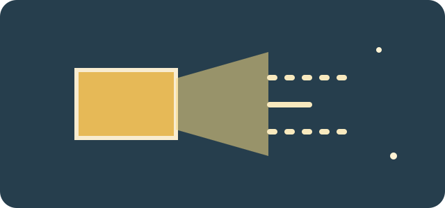

# Day 22 · The Secret Light Message

{ .activity-illustration }

**Field:** Technology · Communication · Patterns  
**Time:** 10–15 minutes (Tuesday 22 December 2026)  
**Age group:** 6–9  
**Progression:** On [Day 21](day-21.md), we compared our cress observations with an earlier prediction. Today we practise SOS and discover how combinations of short and long flashes can encode every letter. Tomorrow, we will plan a Christmas display that can send a light message.

## Introduction

Can a light send a message without using words? In Morse code, combinations of short and long flashes stand for all 26 letters. Practise sending and decoding **SOS**, then use the alphabet key to spell a name or a festive word for the Christmas Signal Station.

By the end of this mission, the child can:

- Recognize that a repeated pattern can represent a message.
- Encode and decode the letters S and O using short and long flashes.
- Use a Morse key to encode another letter or a short word.
- Describe a simple light signal clearly enough for another person to interpret.

**The big question:** How can the same light communicate different letters?

## Materials list

The small flashlight is reusable and included in the box.

| Item | Amount needed | Notes |
| --- | --- | --- |
| Small battery-powered flashlight | 1 | Use a compact LED model; keep its batteries enclosed. |
| Printed Day 22 mission card | 1 folded card | Ordinary paper is fine. |
| Printed A–Z Morse key | 1 sheet, folded | Print separately from the Morse key section below. |
| Quiet indoor space | 1 | Choose a dim room for sending and receiving light signals. Use the included flashlight, not a phone flashlight, and keep the phone away. |
| Pencil | 1 | For writing or decoding the message. |

## What's inside the box?

- [ ] **One small battery-powered flashlight** for sending the light signals.
- [ ] **One folded Day 22 mission card.**
- [ ] **One separately printed, folded A–Z Morse key.**

## Child's mission card

!!! example "🔦 DAY 22 — THE SECRET LIGHT MESSAGE"
    **Your mission:** Send a secret message with light!

    **You need:** Flashlight, Morse key, adult and dim room.

    **SOS key:** **S = 3 short** · **O = 3 long**

    **1. Predict!** What might flashes mean?

    **2. Send!** Flash SOS: three short, three long, three short. Pause between letters.

    **3. Decode!** Ask an adult to send SOS. Can you spot each letter?

    **4. Spell!** Send your name with the key. Pause between letters; ask an adult to decode.

    ⭐ **Scientist's question:** Why pause?

!!! example "🔦 DAG 22 — DET HEMLIGA LJUSMEDDELANDET"
    **Ditt uppdrag:** Skicka och avkoda hemliga ljusmeddelanden!

    **Du behöver:** Ficklampa, morsealfabet A–Z, vuxen och mörkt rum.

    **SOS-nyckel:** **S = 3 korta** · **O = 3 långa**

    **1. Gissa!** Vad betyder tre korta eller långa blinkningar?

    **2. Skicka!** Blinka SOS: tre korta, tre långa, tre korta. Pausa mellan bokstäverna.

    **3. Avkoda!** Be en vuxen skicka SOS. Ser du varje bokstav?

    **4. Stava!** Skicka ditt namn med nyckeln. Pausa mellan bokstäverna; be en vuxen avkoda.

    ⭐ **Forskarens fråga:** Varför behövs pauser?

## A–Z Morse key

<button class="md-button md-button--primary" type="button" data-print-morse-key>Print A–Z Morse key</button>

**Short flash = dot (.) · Long flash = dash (-)**

| Letter | Code | Letter | Code |
| --- | --- | --- | --- |
| A | .- | N | -. |
| B | -... | O | --- |
| C | -.-. | P | .--. |
| D | -.. | Q | --.- |
| E | . | R | .-. |
| F | ..-. | S | ... |
| G | --. | T | - |
| H | .... | U | ..- |
| I | .. | V | ...- |
| J | .--- | W | .-- |
| K | -.- | X | -..- |
| L | .-.. | Y | -.-- |
| M | -- | Z | --.. |

## Morsealfabet A–Z

<button class="md-button md-button--primary" type="button" data-print-morse-key>Skriv ut morsealfabet A–Z</button>

**Kort blinkning = punkt (.) · Lång blinkning = streck (-)**

| Bokstav | Kod | Bokstav | Kod |
| --- | --- | --- | --- |
| A | .- | N | -. |
| B | -... | O | --- |
| C | -.-. | P | .--. |
| D | -.. | Q | --.- |
| E | . | R | .-. |
| F | ..-. | S | ... |
| G | --. | T | - |
| H | .... | U | ..- |
| I | .. | V | ...- |
| J | .--- | W | .-- |
| K | -.- | X | -..- |
| L | .-.. | Y | -.-- |
| M | -- | Z | --.. |

## Adult instructions

### Preparation (1–2 minutes before opening)

1. Check that the flashlight from the box works and is not too bright for the room. Keep it pointed at a wall or a clear surface, not at a person's face.
2. Print the separate A–Z Morse key using the button above. Explain that each letter has a pattern of dots (short flashes) and dashes (long flashes). A short flash can last about half a second; a long one about one and a half seconds.
3. Pack the flashlight, folded mission card and separately printed Morse key. No electrical wiring or Arduino is needed today.

### How to help (10–15 minutes total)

| Time | What to do |
| --- | --- |
| 0–2 min | Explain that a code is a shared set of rules. Practise one short and one long flash. |
| 2–5 min | Send SOS by making three short flashes, a clear letter pause, three long flashes, a pause, then three short flashes. |
| 5–9 min | Take turns sending SOS and decoding it. Ask the listener to identify the three groups. |
| 9–13 min | Use the alphabet key to encode the child's name. Send it slowly, with a clear pause between letters, and take turns decoding. |
| 13–15 min | Turn off the flashlight and discuss how the receiver knew where one letter ended. |

**Keep it a fair comparison:** Keep short and long flashes clearly different, and use the same pause between letters each time. A clear start and end helps the listener decode the message.

### Safety

- Do not shine the flashlight into eyes or across a road, window or public space. Use a wall or a nearby surface as the signal target.
- Do not use rapidly flashing patterns; keep the signals slow and comfortable to watch.
- An adult should supervise the flashlight and keep it away from water.

### Why it works

Morse code represents all 26 letters with patterns of short and long signals. The timing and pauses carry information: a listener can tell which marks belong together and where one letter ends. A flashlight is one way to send the marks; a buzzer or radio can send the same code in other forms.

SOS is a well-known distress signal, but this activity is a practice code, not an emergency communication system. The child is learning how agreed patterns can carry a message.

### Troubleshooting and optional extension

- **The listener cannot tell short from long:** Make the long flash about three times longer than the short one and pause between groups.
- **Letters run together:** Add a longer pause between letters and announce when the message starts.
- **The room is too bright:** Aim the flashlight at a nearby pale wall and shade the area slightly without making the room unsafe to move in.
- **Extra challenge for older children:** Encode **NOEL** with the A–Z key. Write down the dots and dashes before sending, then compare the decoded result.

**Next experiment:** On [Day 23](day-23.md), we will plan and prototype a Christmas display for our light-message invention.

[← Back to the calendar](../index.md) · [← Day 21: The Seed Scientist Returns](day-21.md)