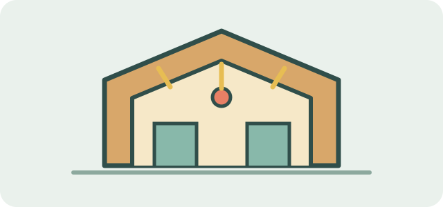

# Day 24 · The Christmas Soap Factory

{ .activity-illustration }

**Field:** Chemistry · States of matter · Mixtures  
**Time:** 40–60 minutes (Thursday 24 December 2026)  
**Age group:** 6–9  
**Progression:** On [Day 23](day-23.md), colours dissolved and spread through water. Today we melt soap, mix in colour and scent, and mould three soaps to give away as Christmas presents.

## Introduction

Can you make a Christmas present with chemistry? Melt a solid soap base into a liquid, colour and scent it, and pour it into moulds. As it cools, it turns solid again, ready to unmould and pack in a gift box.

By the end of this mission, the child can:

- Observe a solid melting into a liquid and turning solid again as it cools.
- Mix colours and scent into the liquid soap and predict the result.
- Explain how soap helps water wash away grease and dirt.

**The big question:** Is melted soap still soap?

## Materials list

The soap materials come from the Forskarfabriken **Tvålfabriken** kit.

| Item | Amount needed | Notes |
| --- | --- | --- |
| Clear melt-and-pour soap base | 150 g | From the kit. |
| White melt-and-pour soap base | 50 g | From the kit. |
| Soap colour (red, blue and yellow) | A tiny amount of each | From the kit (3 g of each). A little goes a long way. |
| Jasmine-scented essential oil | 2–3 drops per soap | From the kit (5 ml). |
| Soap moulds | 3 | From the kit. |
| Plastic melting beaker (100 ml) | 1 | From the kit. |
| Wooden stirring stick | 1 | From the kit. |
| Gift box | 3 | From the kit. |
| Safety glasses | 2 pairs | From the kit; one for the child and one for the adult. |
| Knife and chopping board | 1 each | Adult only, for cutting the soap base into cubes. |
| Microwave or saucepan | 1 | For melting the soap base; follow the kit leaflet. |
| Oven glove or folded tea towel | 1 | For holding the warm beaker. |
| Kitchen paper | A few sheets | For drips and wiping the beaker between colours. |

## What's inside the box?

- [ ] **Three small soap colours** (red, blue and yellow).
- [ ] **One small bottle of jasmine-scented essential oil.**
- [ ] **One wooden stirring stick.**
- [ ] **One folded Day 24 mission card** (below).

**Set out beside the box:** The soap bases cut into cubes, the moulds, the melting beaker, the gift boxes and both pairs of safety glasses.

## Child's mission card

!!! example "🎁 DAY 24 — THE CHRISTMAS SOAP FACTORY"
    **Your mission:** Make soap presents for Christmas!

    **You need:** Soap base, colours, scent, moulds, stirring stick, gift boxes and safety glasses.

    **1. Plan!** Who gets a soap? Choose a colour and shape for each.

    **2. Mix!** When an adult has melted the soap, stir in a tiny bit of colour and 2 drops of scent.

    **3. Pour!** Fill a mould slowly. Try a white layer and a clear layer!

    **4. Wait and wrap!** When the soap is hard, pop it out and put it in a gift box.

    ⭐ **Scientist's question:** Is melted soap still soap?

!!! example "🎁 DAG 24 — JULENS TVÅLFABRIK"
    **Ditt uppdrag:** Gör tvålar som julklappar!

    **Du behöver:** Tvålbas, färger, doft, formar, träpinne, presentlådor och skyddsglasögon.

    **1. Planera!** Vem ska få en tvål? Välj färg och form till varje.

    **2. Blanda!** När en vuxen har smält tvålen, rör ner lite färg och 2 droppar doft.

    **3. Häll!** Fyll en form långsamt. Prova ett vitt lager och ett klart lager!

    **4. Vänta och slå in!** När tvålen är hård, tryck ut den och lägg den i en presentlåda.

    ⭐ **Forskarens fråga:** Är smält tvål fortfarande tvål?

## Setup notes

### Preparation (10 minutes before the activity)

Read the kit leaflet first and follow its melting instructions and temperature limits.

1. Cut the clear and white soap bases into **1–2 cm cubes** and keep them in separate piles. Small cubes melt quickly and evenly.
2. Check that the moulds are clean and dry and place them on a tray on a level surface where they can stand undisturbed.
3. Set out the beaker, stick, colours, scent, kitchen paper, oven glove and gift boxes. Both the adult and the child put on safety glasses.

### How to help (40–60 minutes total)

Three soaps are suggested: a clear coloured soap, a layered white and clear soap, and a soap in a mixed colour.

| Time | What to do |
| --- | --- |
| 0–5 min | Plan who will receive each soap and choose colours and moulds. Ask: if we melt soap and let it harden again, will it still be soap? |
| 5–15 min | **Soap 1:** The adult melts about 50 g clear cubes in the beaker in 20-second microwave bursts, then 10-second bursts, stirring between, until just melted. Do not let it boil. The child stirs in a tiny amount of colour and 2–3 drops of scent, slowly to avoid bubbles. The adult or child pours slowly into a mould. |
| 15–30 min | **Soap 2:** Melt the white base and pour a layer into a mould to about half full. Wait until a firm skin forms, about 5–10 minutes. Gently scratch the surface with the stick, then pour a coloured clear layer on top. |
| 30–40 min | **Soap 3:** Melt the rest of the clear base and mix two colours, such as red and blue to make purple. Add scent and pour. Once each soap has a firm skin, move it to the fridge to set faster. |
| 40–55 min | While the soaps set, wipe the beaker and stick, decorate gift tags and talk about why soap cleans. When a soap is hard all the way through, about 15–20 minutes in the fridge, press it out of the mould from the back. |
| 55–60 min | Pack each soap in a gift box, ready to give away. If the last soap is still soft, unmould it later in the day. |

**Keep it a fair comparison:** Add colour in very small steps. Compare a soap with one tiny pinch of colour with one that has twice as much.

### Safety

- **Melted soap base is hot enough to burn.** An adult melts the soap and handles the hot beaker with an oven glove. Heat in short bursts and stir between them; never let it boil. Let younger children pour only when an adult holds the beaker with them.
- Wear safety glasses while melting, mixing and pouring.
- Do not put essential oil directly on skin, and keep it away from eyes and mouth. Use no more than 2–3 drops per soap. Check whether anyone receiving a soap has allergies to scents.
- Soap colours can stain. Wipe up drips while they are still soft.
- Use the kit's beaker, stick and moulds for soap only, not for food.

### Why it works

The soap base is already finished soap. It was made in a factory by a chemical reaction between oils and a strong base. Today we only **melt** it and let it go **solid** again. That is a physical change: the substance is the same soap before and after, just as ice and water are both water.

Colour spreads through the liquid soap and is locked in place when it hardens. The scent molecules escape into the air and travel to your nose, the same spreading that moved the colours on Day 23. The white base contains tiny particles that scatter light, while the clear base lets light pass through.

Soap cleans because each soap molecule has two different ends: one end likes water and the other likes oil and grease. The oil-loving ends grab the grease, the water-loving ends face outwards, and water can wash the grease away.

### Troubleshooting and optional extension

- **The soap gets hard in the beaker before pouring:** Reheat for 5–10 seconds and stir.
- **There are bubbles on the top:** Pour more slowly and gently pop surface bubbles with the stick right after pouring.
- **The layers separate:** Scratch the first layer before pouring the second, and pour the second layer when it is warm but not very hot.
- **The soap is stuck in the mould:** Put it in the fridge for 10 minutes, then press from the back.
- **Small drops form on the soap:** The soap base attracts moisture from the air. Close the gift box once the soap is fully cool.
- **Extra challenge for older children:** Wash a little cooking oil off your hands with water only, then with your new soap. Explain the difference.

**Next experiment:** The calendar is complete. Merry Christmas, and keep asking questions!

[← Back to the calendar](../index.md) · [← Day 23: The Skittles Rainbow Painting](day-23.md)
